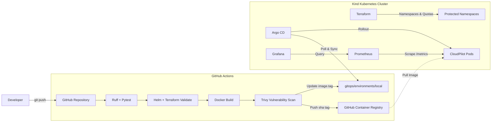

# CloudPilot

A local-first DevOps platform demonstrating automated CI/CD, container vulnerability scanning, Terraform-managed Kubernetes infrastructure, Argo CD GitOps workflows, and Prometheus/Grafana observability.

I built this project to test and practice the full cloud-native delivery lifecycle on a single development machine without needing paid cloud resources. It runs either natively for fast local development or inside a local single-node Kind cluster tuned for modest hardware (~4–5 GB RAM).

---

## Architecture Overview



---

## How It Works

### 1. Application Layer (`/app`)
- **FastAPI backend** running Python 3.11 with Uvicorn.
- **Health probes**: Distinct `/healthz` (liveness) and `/readyz` (readiness) endpoints with startup lifecycle tracking.
- **Observability middleware**: Correlation ID tracking (`X-Correlation-ID`) on every request, structured JSON logging, and a Prometheus metric exporter at `/metrics`.
- **Fault-injection endpoints**: `/api/v1/simulate-error` and `/api/v1/slow` for intentionally testing alerting thresholds and p95 latency graphs.

### 2. CI/CD & Security (`.github/workflows/ci-cd.yml`)
- **Automated Validation**: On pull requests and pushes, GitHub Actions runs Ruff linting, 28 Pytest unit tests, Helm chart linting, and `terraform validate`.
- **Trivy Vulnerability Gates**: Scans the filesystem and container image for critical/high vulnerabilities before publishing.
- **Immutable Tags**: Pushes images to GHCR tagged with Git commit SHAs (`sha-<commit>`), never mutable tags like `:latest`.
- **Automated GitOps Tag Update**: Once the image passes security scans and is pushed, the workflow commits the new image tag to `gitops/environments/local/values.yaml`.

### 3. Container Security (`docker/Dockerfile`)
- **Multi-stage build**: Compiles dependencies in a builder stage and copies only required packages to the runtime layer.
- **Non-root execution**: Runs under a dedicated system user (`UID 10001`).
- **Filesystem restrictions**: Configured with a read-only root filesystem and temporary scratch space mounted via `tmpfs` at `/tmp`.
- **Minimal attack surface**: Drops all default Linux capabilities (`ALL`) and eliminates unneeded build tools from the final image.

### 4. Infrastructure as Code (`infrastructure/terraform`)
- Uses the Terraform Kubernetes provider to provision target namespaces (`cloudpilot`, `monitoring`, `argocd`).
- Enforces namespace boundaries using `ResourceQuota` and `LimitRange` rules to prevent noisy-neighbor memory and CPU starvation.
- Clear separation: Terraform manages infrastructure guardrails, while Argo CD manages application deployments.

### 5. GitOps Delivery (`/gitops`)
- Argo CD tracks `gitops/environments/local/values.yaml` and continuously reconciles desired state against the cluster.
- Implements automated self-healing and pruning.
- Rollbacks are performed via `git revert`, ensuring version control remains the single source of truth.

### 6. Observability & Monitoring (`/monitoring`)
- **Prometheus**: Scrapes application metrics every 30 seconds (request counts, latency buckets, HTTP 5xx rates).
- **Grafana**: Pre-configured dashboard with 10 panels tracking RED metrics (Rate, Errors, Duration), pod restarts, and CPU/memory usage.
- **Alert Rules**: Configured alert definitions for container restarts, service downtime, elevated p95 latency, and high 5xx error rates.

---

## Operating Modes

To allow running on machines with limited RAM (such as an 8 GB laptop), the platform can be started in modular modes:

| Mode | What Runs | Best For | Estimated RAM |
| :--- | :--- | :--- | :--- |
| **Mode 1** | Native FastAPI + Pytest (Local Python) | Fast app development & testing | < 100 MB |
| **Mode 2** | Kind + Terraform + Helm app | Testing local Kubernetes deployments | ~3.0 GB |
| **Mode 3** | Kind + Argo CD + App | Testing GitOps sync & pull workflows | ~3.5 GB |
| **Mode 4** | Kind + App + Prometheus + Grafana | Tuning dashboards & alert metrics | ~3.5 GB |
| **Mode 5** | Full Platform (All components) | Complete end-to-end pipeline | ~4.5 GB |

---

## Quickstart

### Prerequisites
- Python 3.11+
- Git
- Docker Desktop or Rancher Desktop (for Modes 2–5)
- kubectl, Helm, Terraform, and Kind (for cluster deployment)

### 1. Running the App Locally (Mode 1)

```bash
# Clone the repository
git clone https://github.com/Ayyappanmj/cloudpilot.git
cd cloudpilot

# Create environment configuration
cp .env.example .env

# Install development dependencies
pip install -r requirements-dev.txt

# Run linting and test suite
ruff check .
pytest

# Start the application
python -m uvicorn app.main:app --host 127.0.0.1 --port 8000 --reload
```

Once running, access:
- Swagger Documentation: [http://localhost:8000/docs](http://localhost:8000/docs)
- Liveness Probe: [http://localhost:8000/healthz](http://localhost:8000/healthz)
- Readiness Probe: [http://localhost:8000/readyz](http://localhost:8000/readyz)
- Prometheus Metrics: [http://localhost:8000/metrics](http://localhost:8000/metrics)

---

### 2. Running in Kubernetes (Modes 2–5)

Helper scripts are provided in `scripts/` (available in both PowerShell `.ps1` and Bash `.sh`):

```powershell
# Check available memory and system resources
scripts\check-resources.ps1

# Switch to Mode 2 (sets up Kind cluster, applies Terraform, deploys Helm chart)
scripts\switch-mode.ps1 2

# Verify cluster resources and pod health
scripts\verify-platform.ps1

# Launch monitoring (Prometheus + Grafana port-forwards)
scripts\start-monitoring.ps1

# Test a GitOps rollback
scripts\rollback.ps1 git
```

---

## Testing & Quality Checks

Run the verification steps locally before pushing changes:

```bash
# Unit & integration tests (28 tests covering API, health, error envelope, metrics)
pytest -v

# Static analysis
ruff check .

# Validate Helm chart syntax
helm lint deploy/helm/cloudpilot

# Validate Terraform configuration
cd infrastructure/terraform && terraform validate
```

---

## Repository Structure

```text
cloudpilot/
├── .github/workflows/       # GitHub Actions CI/CD pipelines
├── app/                     # FastAPI application source code
│   ├── middleware/          # Correlation ID and Prometheus metrics middleware
│   ├── routers/             # API routes and health endpoints
│   ├── services/            # Readiness and fault-injection logic
│   ├── config.py            # Pydantic Settings configuration
│   └── main.py              # App factory and lifespan handlers
├── deploy/
│   ├── helm/cloudpilot/     # Helm chart definitions
│   └── kubernetes/          # Raw Kubernetes manifests (reference)
├── docker/                  # Hardened multi-stage Dockerfile
├── docs/                    # Architecture, troubleshooting, and runbooks
├── gitops/                  # Argo CD Application and environment values
├── infrastructure/terraform # Namespaces, ResourceQuotas, and LimitRanges
├── monitoring/              # Prometheus alerts and Grafana dashboards
├── scripts/                 # Management scripts (PowerShell & Bash)
└── tests/                   # Pytest test suite (28 test functions)
```

---

## Author

**Ayyappan**  
- GitHub: [@Ayyappanmj](https://github.com/Ayyappanmj)  
- Email: ayyappanmadhuj@gmail.com
