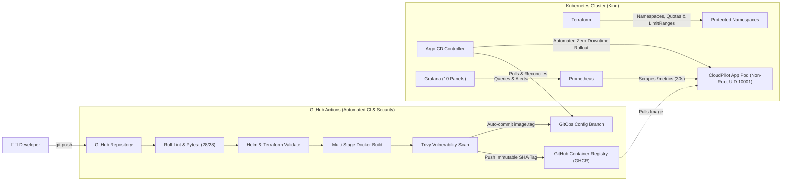

# CloudPilot ✈️
### Enterprise Cloud-Native CI/CD, GitOps & Observability Platform

[](https://www.python.org/)
[](https://fastapi.tiangolo.com/)
[](https://www.docker.com/)
[](https://kubernetes.io/)
[](https://www.terraform.io/)
[](https://argo-cd.readthedocs.io/)
[](https://prometheus.io/)
[](https://grafana.com/)
[](https://github.com/aquasecurity/trivy)
[](tests/)
[](https://github.com/astral-sh/ruff)
[](LICENSE)

---

## 📌 Executive Summary

Manual deployments are slow, error-prone, and painful to roll back. **CloudPilot** is an end-to-end, production-grade cloud-native deployment platform engineered to demonstrate the full modern software delivery lifecycle:

1. **Shift-Left Security & CI**: Every push executes automated linting, unit tests, Helm/Terraform validation, multi-stage Docker builds, and **Trivy CVE vulnerability gating**.
2. **Pull-Based GitOps**: **Argo CD** synchronizes state from Git into **Kubernetes**, ensuring zero cluster credentials leave the cluster boundary and eliminating configuration drift.
3. **Infrastructure as Code (IaC)**: **Terraform** manages cluster namespaces, LimitRanges, and ResourceQuotas to enforce strict tenancy and prevent noisy-neighbor memory exhaustion.
4. **End-to-End Observability**: Custom telemetry middleware exports real-time latency histograms and 5xx counters to **Prometheus**, visualized on an auto-provisioned 10-panel **Grafana** dashboard with alert rules.
5. **Zero-Cloud Cost Architecture**: Carefully tuned to run either natively or within a single-node local Kubernetes cluster—delivering enterprise DevOps patterns with **zero cloud bill**.

---

## 🏗️ Architecture



---

## 🌟 Key Technical Highlights

### 1. 🛡️ Shift-Left Security & Container Hardening
- **Least Privilege Execution**: Pod runs as non-root (explicit numeric `UID 10001`), drops all Linux capabilities (`cap_drop: [ALL]`), disables privilege escalation, and enforces `seccomp: RuntimeDefault`.
- **Read-Only Root Filesystem**: Application filesystem is mounted read-only, preventing post-exploitation persistence. Temporary scratch space is isolated to an in-memory `tmpfs` mount at `/tmp`.
- **Automated Security Gate**: GitHub Actions runs Trivy filesystem and container scans; builds fail automatically on unmitigated HIGH or CRITICAL fixable CVEs.
- **Traceable Releases**: Images are tagged strictly with immutable Git commit SHAs (no ambiguous `:latest` tags).

### 2. 🔄 Declarative GitOps & Instant Rollbacks
- **Zero Cluster Secrets in CI**: Uses pull-based GitOps via Argo CD. CI never holds production cluster access tokens.
- **Automated Reconcile & Self-Healing**: Argo CD monitors `gitops/environments/local/values.yaml` and continuously reconciles cluster drift.
- **Deterministic Rollbacks**: Rollback is executed cleanly via `git revert`, keeping version control as the single source of truth without conflicting with Argo's self-healing controller.

### 3. ⚙️ Infrastructure as Code (Terraform)
- **Separation of Concerns**: Terraform manages infrastructure boundaries (Namespaces, Pod Security standards, ResourceQuotas, LimitRanges) while Argo CD manages workloads, preventing controller state contention.
- **Starvation Protection**: Quotas ensure a single noisy application cannot consume host CPU/memory resources or starve cluster-critical pods.

### 4. 📊 Full-Stack Observability & Reliability
- **Structured JSON Logs**: Logs output machine-parseable JSON with correlation IDs injected via custom middleware for distributed tracing.
- **Application Probes**: Separate `/healthz` (liveness) and `/readyz` (readiness) endpoints with graceful lifecycle management.
- **Prometheus Telemetry**: Exports real-time request rates, latency distribution buckets (`cloudpilot_http_request_duration_seconds_bucket`), error counts, and deployment info gauges.
- **Pre-Provisioned Grafana Dashboard**: 10 purpose-built panels tracking RED metrics (Rate, Errors, Duration), pod restarts, and resource utilization.
- **Built-in Fault Injection**: Safe endpoints (`/api/v1/simulate-error`, `/api/v1/slow`) built to test alerts, latency thresholds, and auto-scaling rules.

---

## 🚦 Operating Modes (Engineered for Any Machine)

CloudPilot features 5 distinct operating modes, allowing full local execution even on resource-constrained laptops (e.g., 8 GB RAM):

| Mode | Target Components | Architecture | RAM Footprint |
| :---: | :--- | :--- | :---: |
| **Mode 1** | **Development** | Native FastAPI + Pytest (or Docker Compose) | **< 100 MB** (Native) |
| **Mode 2** | **Kubernetes** | Kind Cluster + Terraform + Helm Deploy | ~3.0 GB |
| **Mode 3** | **GitOps** | Kind Cluster + Argo CD + Automated Sync | ~3.5 GB |
| **Mode 4** | **Observability** | Kind Cluster + App + Prometheus + Grafana | ~3.5 GB |
| **Mode 5** | **Complete Platform** | Full Production Stack (All components running) | ~4.5 GB |

---

## 🚀 Quick Start

### 1. Instant Local Run (Mode 1 - Zero Docker Required)
You can run and test the complete application natively in seconds:

```powershell
# Clone the repository
git clone https://github.com/your-username/cloudpilot.git
cd cloudpilot

# Configure environment
Copy-Item .env.example .env

# Install dependencies
pip install -r requirements-dev.txt

# Run the automated test suite
pytest

# Verify code style and linting
ruff check .

# Start the server with live reload
python -m uvicorn app.main:app --host 127.0.0.1 --port 8000 --reload
```

Once running, explore the live interfaces:
- **Interactive API Documentation (Swagger):** [http://127.0.0.1:8000/docs](http://127.0.0.1:8000/docs)
- **Alternative API Reference (ReDoc):** [http://127.0.0.1:8000/redoc](http://127.0.0.1:8000/redoc)
- **Prometheus Metrics Stream:** [http://127.0.0.1:8000/metrics](http://127.0.0.1:8000/metrics)
- **Service Readiness & Health:** [http://127.0.0.1:8000/readyz](http://127.0.0.1:8000/readyz)

---

### 2. Full Containerized Kubernetes & GitOps (Modes 2–5)
When Docker Desktop or Rancher Desktop is available:

```powershell
# Check available resources
scripts\check-resources.ps1

# Switch to Mode 2 (Kubernetes + Terraform + Helm)
scripts\switch-mode.ps1 2

# Verify live cluster status
scripts\verify-platform.ps1

# Start Prometheus + Grafana Observability
scripts\start-monitoring.ps1

# Perform safe Git-revert rollback test
scripts\rollback.ps1 git
```

---

## 🧪 Testing & Verification

The project includes a comprehensive automated test suite and verification scripts:

```powershell
# Run 28 test functions covering health, API, telemetry, exceptions, and validation
pytest -v

# Static analysis and linting
ruff check .

# Helm chart validation
helm lint deploy/helm/cloudpilot

# Terraform syntax and schema validation
terraform -chdir=infrastructure/terraform validate
```

```
============================== 28 passed in 0.49s ==============================
```

---

## 📂 Project Structure

```text
cloudpilot/
├── .github/workflows/       # GitHub Actions CI/CD pipeline (lint, test, Trivy, GHCR push)
├── app/                     # Python FastAPI microservice
│   ├── middleware/          # Correlation ID & Prometheus telemetry middleware
│   ├── routers/             # Core routes (/healthz, /readyz) & API endpoints
│   ├── services/            # Fault injection & readiness state services
│   ├── config.py            # Pydantic Settings configuration (CLOUDPILOT_ prefix)
│   ├── exceptions.py        # Centralized exception handlers & standardized error envelope
│   ├── logging_config.py    # Structured JSON log formatting
│   ├── main.py              # Application factory & lifespan handlers
│   └── metrics.py           # Prometheus counters, histograms, and gauges
├── deploy/
│   ├── helm/cloudpilot/     # Helm chart (Deployment, Service, HPA, PDB, NetworkPolicy)
│   └── kubernetes/          # Raw Kubernetes manifests reference
├── docker/
│   └── Dockerfile           # Multi-stage, non-root, hardened Docker build
├── docs/                    # 15 detailed engineering & operational guides
├── gitops/                  # Argo CD Application manifest & environment values
├── infrastructure/
│   └── terraform/           # Terraform modules (Namespaces, Quotas, LimitRanges)
├── monitoring/
│   ├── alerts/              # Prometheus alert rules (Down, 5xx rate, Latency, Restarts)
│   ├── grafana/             # 10-panel provisioned Grafana dashboard JSON
│   └── prometheus/          # Scrape configs & compose definitions
├── scripts/                 # Automated PowerShell & Bash management scripts
└── tests/                   # 28 Pytest unit and integration test functions
```

---

## 👨‍💻 Author & Contributions

Built by **Ayyappan** to demonstrate real-world cloud-native engineering practices.

- **GitHub:** [@Ayyappanmj](https://github.com/Ayyappanmj)
- **LinkedIn:** [Ayyappan on LinkedIn](https://www.linkedin.com/in/)
- **Email:** ayyappanmadhuj@gmail.com

*Feedback, suggestions, and stars are always appreciated! ⭐*
