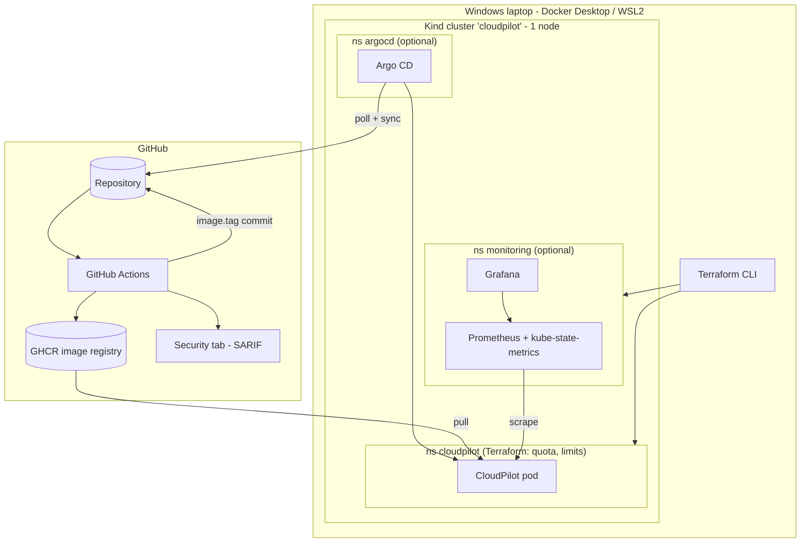
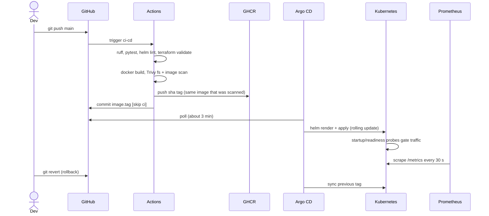

# Architecture

Everything below exists in this repository. Optional pieces are marked.

## Components
| Component | Responsibility | Lives in |
|---|---|---|
| FastAPI service | Business endpoints, health, Prometheus metrics | `app/` |
| Docker image | Reproducible, non-root runtime | `docker/Dockerfile` |
| GitHub Actions | Lint, test, validate, build, scan, publish, GitOps commit | `.github/workflows/ci-cd.yml` |
| GHCR | Stores images tagged `sha-<12 chars>` (+ `latest`) | GitHub |
| Terraform | Namespaces, ResourceQuota, LimitRange, Pod Security labels | `infrastructure/terraform/` |
| Helm chart | Packages the app (Deployment, Service, ConfigMap, SA, NetworkPolicy; HPA/PDB optional) | `deploy/helm/cloudpilot/` |
| Argo CD (Modes 3, 5) | Syncs `gitops/environments/local/values.yaml` + chart into the cluster | `gitops/argocd/application.yaml` |
| Prometheus (Modes 4, 5) | Scrapes app `/metrics`, kubelet cAdvisor, kube-state-metrics; evaluates alert rules | `monitoring/prometheus`, `monitoring/alerts` |
| Grafana (Modes 4, 5) | Provisioned dashboard `CloudPilot Overview` | `monitoring/grafana` |
| Kind | Single-node local Kubernetes | `kind/kind-config.yaml` |

## Ownership boundaries (no tool fights another)
- **Terraform** owns: namespaces `cloudpilot`, `monitoring`; quotas; limit ranges.
- **Argo CD *or* Helm CLI** owns (never both): everything the chart renders in `cloudpilot`.
- **Helm CLI** owns Prometheus/Grafana releases in `monitoring`.
- **GitHub Actions** is the only writer of `image.tag` in the GitOps values file.

## Diagram

## Deployment sequence

## Security architecture
Least-privilege workflow permissions per job; PRs get no write tokens; non-root, read-only-FS, no-capabilities pods; `restricted`
Pod Security on the app namespace; quotas/limit ranges; no secrets in Git; `automountServiceAccountToken: false`.

## Failure recovery
Bad image -> old ReplicaSet keeps serving (`maxUnavailable: 0`); readiness failure -> traffic withheld; crash -> kubelet restarts;
drift -> Argo self-heal; bad release -> `git revert`. Walkthroughs: `docs/FAILURE_SIMULATION.md`.
